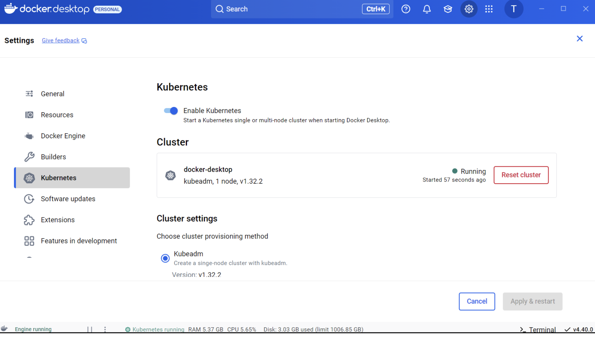
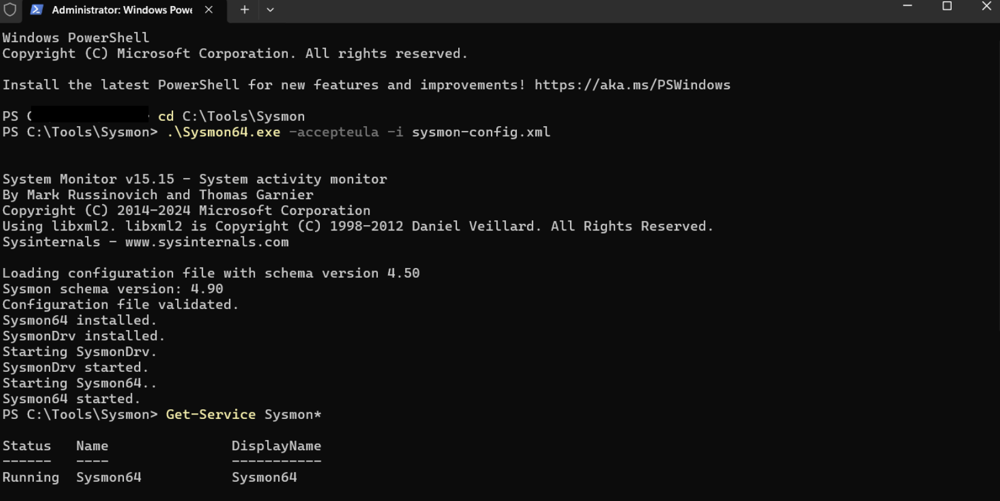
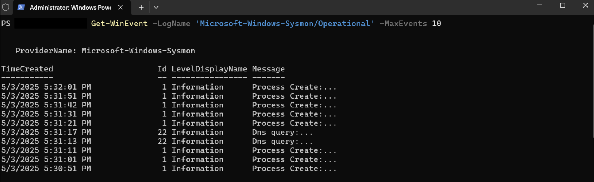
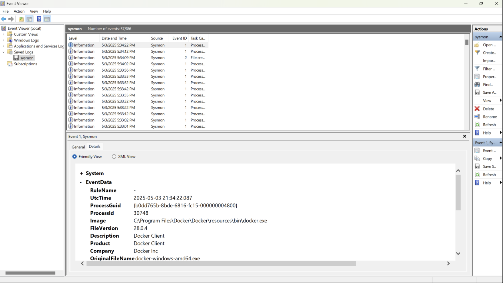
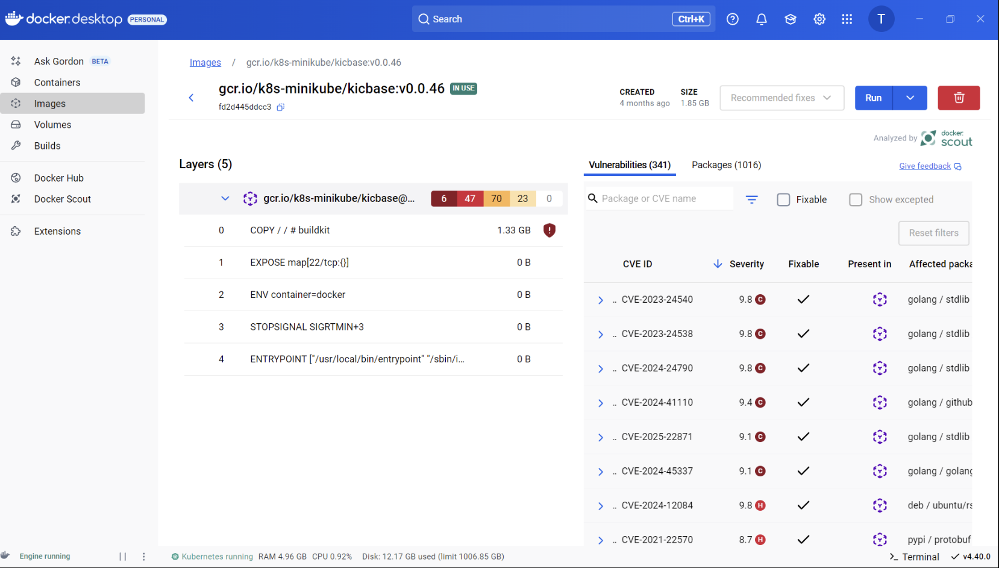
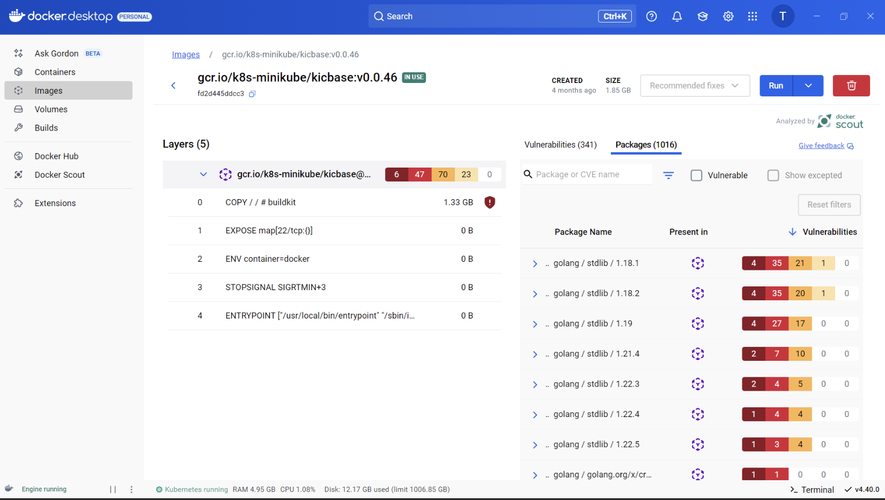
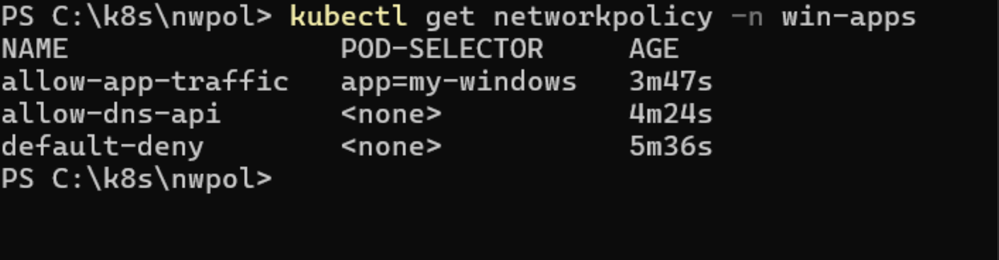
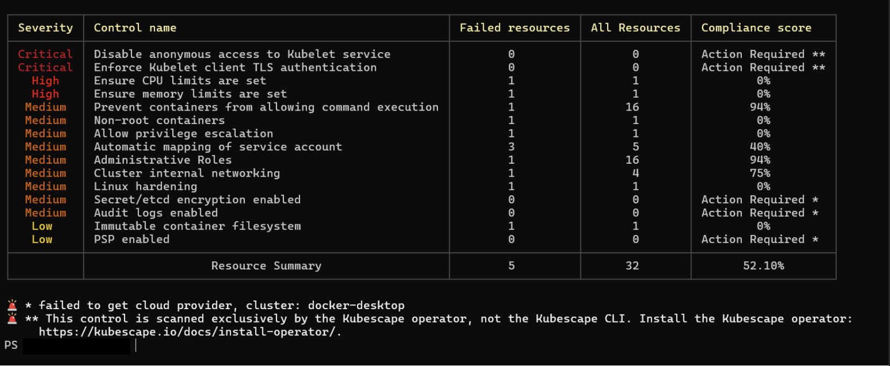

# Securing Kubernetes on Windows Home

A hands-on exercise in building a layered security setup for a Docker Desktop Kubernetes cluster on **Windows 11 Home**.

## Overview

Containerized environments are widely used in production, but they add new attack surface, especially on non-enterprise platforms. This project assembles monitoring, malware detection, network isolation, image scanning, and compliance auditing on a single-node cluster, then tests each layer.

## Tools used

| Layer | Tool | Purpose |
|---|---|---|
| Cluster | Docker Desktop + Kubernetes (kubeadm, v1.32.2) | Single-node local cluster |
| Endpoint monitoring | Sysmon (SwiftOnSecurity config) | Process, DNS, registry and file event logging |
| Malware detection | Microsoft Defender Antivirus | EICAR test detection and quarantine |
| Networking | Cilium (Helm) + Kubernetes NetworkPolicies | Default-deny, DNS/API egress, restricted ingress |
| Image scanning | Docker Scout | CVE reporting for container images |
| Compliance audit | Kubescape (NSA/CISA framework) | Cluster misconfiguration report |

## Phases

### 1. Environment setup
Enabled Kubernetes in Docker Desktop, installed Sysmon with a validated config, confirmed Defender protections were on, and installed Cilium with Helm.

### 2. Malware detection test
Created the standard EICAR test file. Microsoft Defender raised **Event ID 1116** (detection) and **Event ID 1117** (action taken), confirming real-time protection was working.

Windows containers can't be scheduled on a Linux-only Docker Desktop node, so this test ran on the host and not as a pod in the cluster.

### 3. Log observation with Sysmon
Queried the Sysmon operational log in PowerShell and Event Viewer. Process creation (Event ID 1) and DNS query (Event ID 22) events showed Docker process lineage, including parent process, command line and integrity level.

### 4. Container image scanning
Docker Scout analyzed `gcr.io/k8s-minikube/kicbase:v0.0.46` and found **341 vulnerabilities** (6 critical, 47 high, 70 medium), mostly in the Go standard library across several versions.

### 5. Network hardening
Applied three NetworkPolicies in the `win-apps` namespace (see [`k8s/network-policies`](k8s/network-policies)):

- `default-deny`: blocks all ingress and egress by default
- `allow-dns-api`: allows egress to cluster DNS (UDP 53) and the API service range (TCP 443)
- `allow-app-traffic`: allows ingress on TCP 8080 only between pods labelled `app: my-windows`

### 6. Compliance audit with Kubescape
Scanned the cluster against the NSA/CISA Kubernetes Hardening Guidance. The CLI run reported **25 controls: 10 passed, 10 failed, 5 requiring action**, with an overall compliance score of about **52%**. Findings included missing CPU and memory limits, privilege escalation allowed, containers running as root, and administrative roles. The full HTML output is in [`reports/`](reports/kubescape-nsa-report.html).

## Limitations and known gaps

- **Single-node cluster:** this skips multi-node concerns such as inter-node communication, certificate rotation and external etcd security, so the findings don't generalize to production.
- **No Windows containers in Kubernetes:** Windows Home has no Hyper-V, so workloads were Linux-only and the malware test ran on the host.
- **Cilium:** the agent pod was still initializing in the captured output, so I did not independently verify NetworkPolicy enforcement. The expected behavior (DNS allowed, outbound ping blocked) is documented but not shown with captured test output.
- **Defender:** this used Microsoft Defender Antivirus on Windows Home, not Defender for Endpoint (which requires enterprise licensing).
- **RBAC:** there was only one user and no external identity provider, so user-based access restrictions couldn't be meaningfully tested. Kubescape did flag administrative role findings.
- **Sysmon visibility:** Sysmon captured host-level activity well but had limited visibility into Linux container workloads.
- **Kubescape results:** the HTML report (18 failed) and CLI summary (10 failed) differ because of different scan settings and namespace exclusions.

## More to explore

- Run on a multi-node cluster (kind, k3s or a cloud-managed cluster) to test Cilium and RBAC properly
- Capture real NetworkPolicy test output from a busybox test pod
- Fix the Kubescape findings (resource limits, non-root user, no privilege escalation) and re-scan to show before/after scores
- Scan and patch the base images, then re-run Docker Scout

## Notes

- Sysmon configuration is based on [SwiftOnSecurity/sysmon-config](https://github.com/SwiftOnSecurity/sysmon-config).
- Code and configs are MIT licensed. Screenshots and written content are © Tanzila Tabassum.

